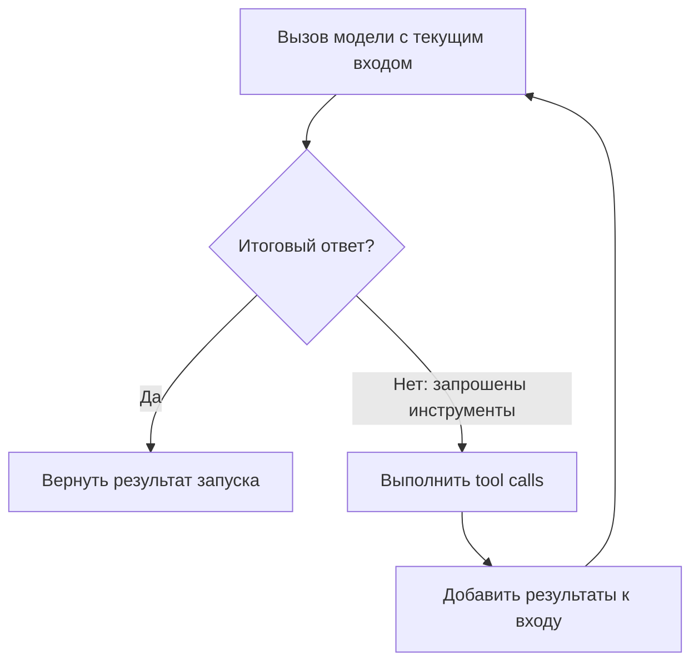

# OpenAI Agents SDK Runner

`Runner` — класс OpenAI Agents SDK для выполнения агентного цикла. Он вызывает модель, исполняет запрошенные инструменты, добавляет результаты к входу следующей итерации и завершает цикл при итоговом ответе. Он также поддерживает handoff между агентами и ограничение `max_turns`.

## Ответственность и интерфейс

**Вход:** начальный агент (`starting_agent`), сообщение или список входных элементов (`input`); при возобновлении возможен `RunState`. Настройки запуска передаются отдельно.

**Выход:** результат запуска с итоговым ответом (`final_output`) и данными исполнения. В потоковом режиме события читаются по мере выполнения.

| Метод | Назначение | Результат |
| --- | --- | --- |
| `await Runner.run(...)` | Асинхронный запуск | `RunResult` |
| `Runner.run_sync(...)` | Синхронная обёртка запуска | `RunResult` |
| `Runner.run_streamed(...)` | Запуск с потоком событий | `RunResultStreaming` |

`run_sync` применяется вне уже работающего event loop; внутри асинхронного приложения используется `run`.

## Условия завершения

Итоговый ответ завершает цикл, когда Runner классифицирует вывод модели как финальный. В описанном документацией правиле это вывод требуемого типа без tool calls. При tool calls Runner обеспечивает их выполнение, добавляет результаты и продолжает цикл. При handoff меняется текущий агент.

`max_turns` ограничивает число обращений к модели в запуске; превышение вызывает `MaxTurnsExceeded`. Это число итераций, а не число отдельных вызовов инструментов. Значение `None` отключает этот лимит. Внешние ошибки и guardrails также могут прервать запуск.

## Сценарий одного агента

Сценарий ограничен успешными SDK-side вызовами инструментов: handoff, hosted tools, approvals и обработка ошибок здесь не показаны. Один ответ модели может содержать несколько tool calls. Runner добавляет их результаты перед следующим обращением к модели.

Прямоугольники обозначают локальные действия этого сценария, стрелки — порядок исполнения. Это не новые Knowledge и не типизированные YAML-рёбра. Проверка `max_turns` описана в разделе «Условия завершения» и опущена на схеме.

Связанные понятия: [[knowledge/entries/tool-call|Tool Call]] и [[knowledge/entries/tool-result|Tool Result]]. Эти ссылки служат навигации; каноническое отношение Runner к циклу записано в YAML как `realizes`.

Описание основано на разделах [The agent loop](https://openai.github.io/openai-agents-python/running_agents/#the-agent-loop) и [Runner API](https://openai.github.io/openai-agents-python/ref/run/). Параметры и шаги оставлены внутри этой заметки, поскольку для данного примера им не требуется самостоятельная идентичность.
