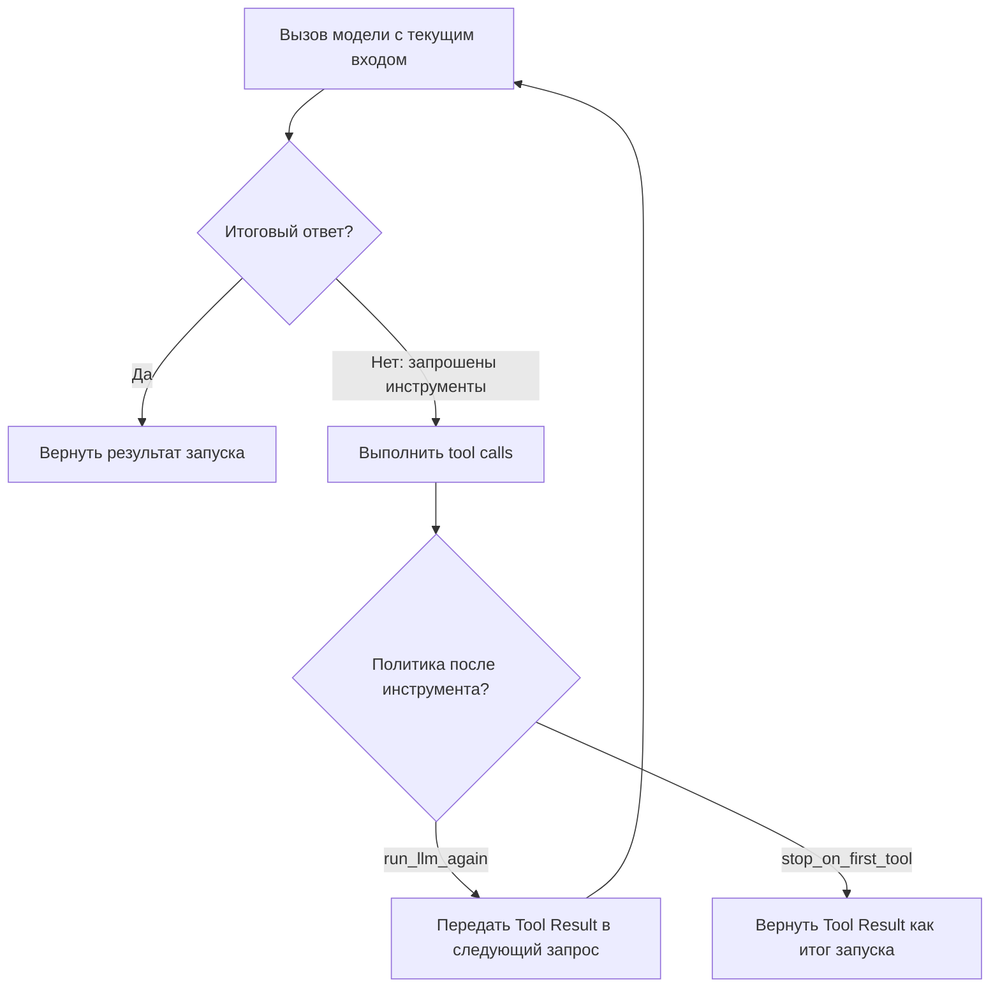

# OpenAI Agents SDK Runner

`Runner` — класс OpenAI Agents SDK для выполнения агентного цикла. Он вызывает модель и обеспечивает исполнение запрошенных локальных инструментов. В зависимости от `tool_use_behavior` результаты передаются в следующий вызов модели или могут стать итогом запуска; цикл также завершается при финальном ответе модели. Он также поддерживает handoff между агентами и ограничение `max_turns`.

## Ответственность и интерфейс

**Вход:** начальный агент (`starting_agent`), сообщение или список входных элементов (`input`); при возобновлении возможен `RunState`. Настройки запуска передаются отдельно.

**Выход:** результат запуска с итоговым ответом (`final_output`) и данными исполнения. В потоковом режиме события читаются по мере выполнения.

| Метод | Назначение | Результат |
| --- | --- | --- |
| `await Runner.run(...)` | Асинхронный запуск | `RunResult` |
| `Runner.run_sync(...)` | Синхронная обёртка запуска | `RunResult` |
| `Runner.run_streamed(...)` | Запуск с потоком событий | `RunResultStreaming` |

`run_sync` применяется вне уже работающего event loop; внутри асинхронного приложения используется `run`.

## Условия завершения

Итоговый ответ завершает цикл, когда Runner классифицирует вывод модели как финальный. В описанном документацией правиле это вывод требуемого типа без tool calls. При локальных tool calls Runner обеспечивает выполнение; политика `run_llm_again` передаёт результаты в следующую итерацию модели, а `stop_on_first_tool` завершает запуск результатом первого локального инструмента. При handoff меняется текущий агент.

`max_turns` ограничивает число обращений к модели в запуске; превышение вызывает `MaxTurnsExceeded`. Это число итераций, а не число отдельных вызовов инструментов. Значение `None` отключает этот лимит. Внешние ошибки и guardrails также могут прервать запуск.

## Сценарий одного агента

Сценарий ограничен успешными SDK-side вызовами локальных инструментов: handoff, hosted tools, approvals и обработка ошибок здесь не показаны. На схеме показан один вызов инструмента. При `run_llm_again` его результат передаётся модели; при `stop_on_first_tool` становится итогом запуска.

Прямоугольники обозначают локальные действия, стрелки — допустимые переходы при подписанных условиях. Это не новые Knowledge и не типизированные YAML-рёбра. Проверка `max_turns` описана в разделе «Условия завершения» и опущена на схеме.

## Движение данных: один вызов инструмента

| Условие | Источник → получатель | Передаваемые данные | Назначение |
| --- | --- | --- | --- |
| Начало `run` | Приложение → Runner | Стартовый Agent и пользовательский запрос | Настроить и запустить исполнение |
| Первый `turn` | Runner → модель | Запрос и описание доступного `get_weather` | Дать модели возможность выбрать инструмент |
| Ответ модели | Модель → Runner | `Tool Call`: `get_weather(city="Tokyo")`, `call_id="call_1"` | Запросить действие |
| Исполнение инструмента | Runner → `get_weather` → Runner | Аргумент `city` и строка `"Tokyo: sunny"` | Получить `Tool Result` |
| Только `run_llm_again` | Runner → модель, второй `turn` | `function_call_output` с `call_id="call_1"` | Продолжить агентный цикл |
| Только `stop_on_first_tool` | Runner → приложение | `RunResult.final_output = "Tokyo: sunny"` | Завершить без второго вызова модели |
| После финального ответа модели | Runner → приложение | `RunResult.final_output` с ответом модели | Завершить основной сценарий |

## Условные переходы

| Текущее состояние | Условие | Следующее действие / исход |
| --- | --- | --- |
| Ответ модели содержит локальный `Tool Call` | Инструмент доступен и вызов успешен | Runner исполняет локальный инструмент |
| `Tool Result` получен | `tool_use_behavior="run_llm_again"` | Результат включается во вход второго `turn` |
| `Tool Result` получен | `tool_use_behavior="stop_on_first_tool"` | Результат становится `final_output`, второго `turn` нет |
| Модель вернула финальный ответ | Вызовы инструментов не требуются | Runner завершает `run` |
| Превышен `max_turns` | Нет пользовательского обработчика | `MaxTurnsExceeded` |

Эти таблицы описывают **условно допустимое поведение** SDK на выбранном сценарии. `call_1` и `Tokyo` — значения теста, а не отдельные Knowledge. Фактические события устанавливаются только по выполненному тесту/trace.

Связанные понятия: [[knowledge/entries/tool-call|Tool Call]] и [[knowledge/entries/tool-result|Tool Result]]. Эти ссылки служат навигации; каноническое отношение Runner к циклу записано в YAML как `realizes`.

Описание основано на разделах [The agent loop](https://openai.github.io/openai-agents-python/running_agents/#the-agent-loop) и [Runner API](https://openai.github.io/openai-agents-python/ref/run/). Параметры и шаги оставлены внутри этой заметки, поскольку для данного примера им не требуется самостоятельная идентичность.
